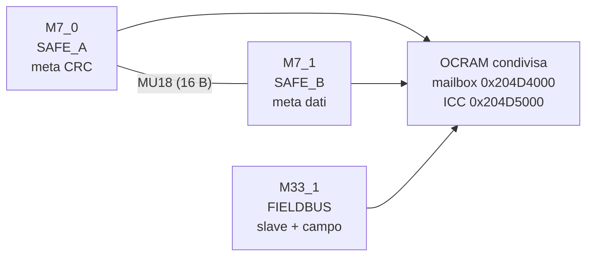

# Architettura del virtual safe PLC {#architettura}

Il *virtual safe PLC* e' un 1oo2: due core indipendenti eseguono lo stesso
codice di sicurezza e si scambiano il risultato; una divergenza porta le uscite
a zero. Il campo (lo slave FSoE e gli ingressi) e' simulato da un terzo core,
che nell'architettura originale sarebbe l'A55 con EtherCAT e che qui non e' un
componente di sicurezza.

## Ruoli e mappatura {#ruoli}

| App | Core | Costante | Ruolo |
|---|---|---|---|
| `fw/m70` | M7_0 @ 800 MHz | `SAFE_A` | master FSoE #1, pubblica la *meta' CRC* del frame, lato *B* della MU18 |
| `fw/m71` | M7_1 @ 800 MHz | `SAFE_B` | master FSoE #2, pubblica la *meta' dati*, lato *A* della MU18 |
| `fw/m33s` | M33_1 @ 266 MHz | `FIELDBUS` | ruolo A55: unisce le due meta', esegue lo slave FSoE, genera il campo |

La scelta non e' arbitraria: la MU18 e' l'*unica* MU che collega due core
secondari fra loro, e i suoi lati sono cablati: A su M7_1, B su M7_0. Il M33_1
non ha nessuna MU verso gli M7 (le sue vanno verso l'SM e l'AP). Quindi un 1oo2
con cross-check su MU puo' stare solo sui due M7, e il campo deve stare sul
M33_1, che di MU non ha bisogno perche' parla solo attraverso la memoria
condivisa.

I dettagli dei tipi e dei protocolli stanno in @ref flow_icc, @ref flow_mu e
@ref flow_shm; gli indirizzi e i tempi in @ref flow_config.

## Struttura del codice {#struttura-codice}

Il codice segue i ruoli: ogni app linka *solo* i sorgenti del proprio ruolo e il
ruolo e' un argomento del punto di ingresso, non una macro di build. Un core non
compila mai il codice dell'altro e il revisore legge una strada sola.

| Cartella | Contenuto | Linkata da |
|---|---|---|
| `fw/m70`, `fw/m71`, `fw/m33s` | solo wiring dell'app: `board_init()`, banner, punto di ingresso del ruolo | - |
| `fw/safe/` | ruolo 1oo2: i 4 passi, la logica safe, le callback lato master, il ciclo, il lato MU18 | `m70`, `m71` |
| `fw/fieldbus/` | ruolo campo: slave FSoE, campo simulato, merge A55, callback lato slave, ciclo | `m33s` |
| `fw/common/flow/` | ABI e astrazioni condivise: tipi e config, mailbox, ICC, MU, CRC, mem, selftest KAT, port FSoE | tutti |
| `fw/common/` | glue di board: SCMI, RTT, linker script, HAL della piattaforma | tutti |
| `fw/common/fsoe/` | libreria rt-labs vendored, non si modifica | tutti, archivio per app |

I confini:

- il codice di un ruolo sta in `fw/safe/` o `fw/fieldbus/`, mai in `common/`;
- in `fw/common/flow/` vive cio' che serve identico a piu' ruoli e *non
  conosce* il ruolo: al piu' lo riceve come parametro `flow_core_id_t`, mai come
  macro che accende pezzi di file;
- la variabilita' ha un solo punto di dispatch: `ROLE` in `imx94_firmware()`
  sceglie i sorgenti, il `main.c` dell'app passa la propria identita'
  (`safe_main(FLOW_CORE_SAFE_A)`, `safe_main(FLOW_CORE_SAFE_B)`,
  `fieldbus_main()`);
- un protocollo condiviso resta in `common/flow/` anche se oggi lo usa un ruolo
  solo (mailbox, cross-check, ICC): e' ABI documentata nei suoi header e i suoi
  `_Static_assert` sono il contratto.

## Mappa di memoria {#memoria}

Tutto cio' che e' condiviso sta in OCRAM: la DDR non e' inizializzata da
`flash.bin`, quindi non e' utilizzabile dai core secondari. Le due finestre sono
concesse alle tre LM dalla patch SM 0002 (la prima dalla 0001), e la loro
scrittura e' la prova che il TRDC e' configurato bene.

| Indirizzo | Dimensione | Uso |
|---|---|---|
| `0x204D0000` | 16 KB | control block RTT condiviso, un canale per core (patch SM 0001) |
| `0x204D4000` | 16 KB | mailbox FSoE (`flow_shm_t`; patch SM 0002) |
| `0x204D5000` | 1 KB | canale di cross-check (`flow_icc_t`) e barrier di ciclo |
| `0x204D5400`... | ~11 KB | riserva per crescita e guardia |

Al boot ogni core scrive e rilegge due word nelle due finestre
(`flow_selftest`): se il TRDC non concede l'area, il fault arriva subito e non a
meta' ciclo.

> Nel `flow_shm_t` l'header e' pubblicato con il `magic` *per ultimo* (store
> release) e `flow_shm_validate()` richiede anche `state = READY`: chi legge non
> vede mai una mailbox a meta' inizializzazione. Il ruolo `FIELDBUS` e' l'unico
> che la inizializza, i due core safe la aspettano con un timeout (2 s) e vanno
> in fail-safe se non arriva.

## Protocolli {#protocolli}

Il 1oo2 ha bisogno di tre cose che non sono FSoE e che vanno protette a mano:
il passaggio dei frame fra i core e il campo (mailbox), lo scambio dei risultati
fra i due core (cross-check) e la sincronizzazione del ciclo (barrier). Nessuna
delle tre e' un canale di sicurezza certificato: sono i *mezzi*, mentre la
garanzia end-to-end resta il CRC FSoE.

- **Mailbox**: due canali TX (uno per core) e uno RX (del fieldbus), tre banchi
  con seqlock e CRC-16 sui metadati. Il frame e' spezzato: `SAFE_A` scrive solo
  i byte CRC della PDU, `SAFE_B` solo i byte dati; il fieldbus prende il frame
  con `MIN(count_A, count_B)` e interleave le due meta'. Dettagli in
  @ref flow_shm_api.h e @ref flow_shm.
- **Cross-check**: messaggio con routing, sequenza indipendente e CRC-32; il
  payload sta in uno slot OCRAM, la MU18 porta solo il doorbell
  `{seq, tag, channel}` + CRC-32. Il ricevente ricalcola il CRC: due mezzi
  fisici indipendenti devono dire la stessa cosa. Dettagli in @ref flow_mu e
  @ref flow_icc.
- **Barrier**: il numero di ciclo lo scrive *solo* il FIELDBUS; i core safe
  pubblicano `ready[me]` e aspettano che `cycle` cambi. C'e' un gate d'avvio e
  un timeout di 30 ms. Dettagli in @ref flow_icc.

## FSoE e logica safe {#fsoe}

Lo stack di rt-labs e' compilato come libreria statica (`libfsoe-<app>.a`) con
un port minimo (`fw/common/flow/port/fsoeport.c`): tempo da `DWT->CYCCNT`,
`memcpy`/`memset` da newlib-nano, e `FSOEPORT_ASSERT` mappato su
`flow_platform_fatal` (un'asserzione violata non e' un `printf`: e' lo stato
sicuro).

La progressione e' quella standard, identica sui due master:

| Stato | Cosa succede |
|---|---|
| `Reset` | il master chiede la connessione con un frame di reset; lo slave risponde |
| `Session` | si negozia il Session ID |
| `Connection` | si stabilisce la connessione (Connection ID) |
| `Parameter` | si scambiano watchdog e parametri applicativi |
| `Data` | dati di processo in entrambe le direzioni |

Il *Session ID* e' l'unico valore che i due core devono *coordinare* invece di
calcolare: ciascuno genera un numero casuale con il proprio RNG, lo scambia, e
il Session ID finale e' la *somma dei due*. Il watchdog FSoE e' a 100 ms, dieci
volte il ciclo safe. La macchina a stati e' documentata in
@ref fsoe_states; la logica pura (ingressi, latch, reset, uscite) in
@ref flow_safe_logic.h.

## Limiti {#limiti-arch}

Questo e' un banco di prova, non un prodotto certificato: la diversita' dei core
non c'e' (due M7 identici), mancano MPU/ECC, TRNG vero, watchdog esterni e la
catena di campo reale. Vedi @ref limiti e @ref misure.
